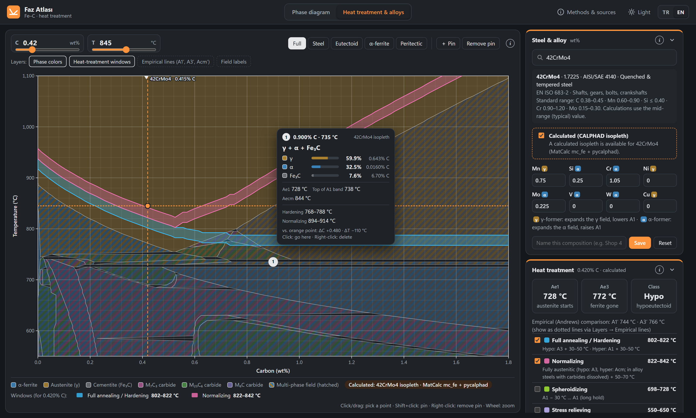
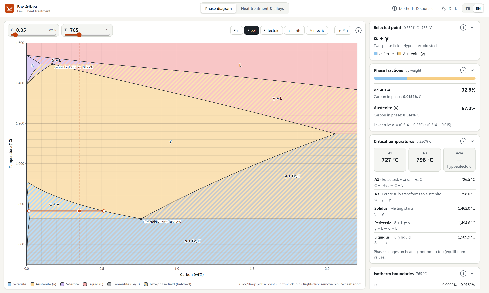
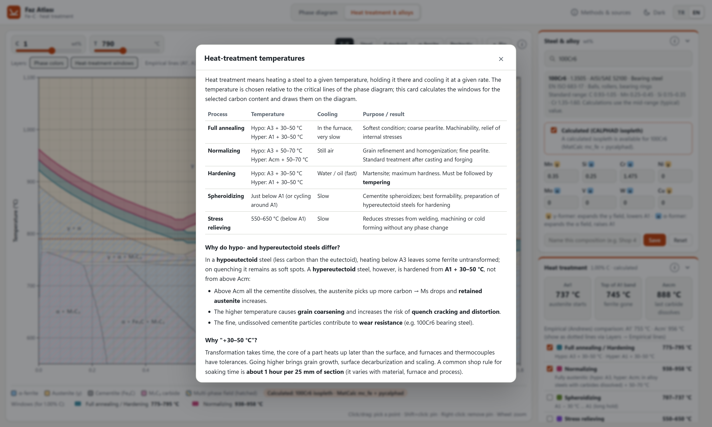
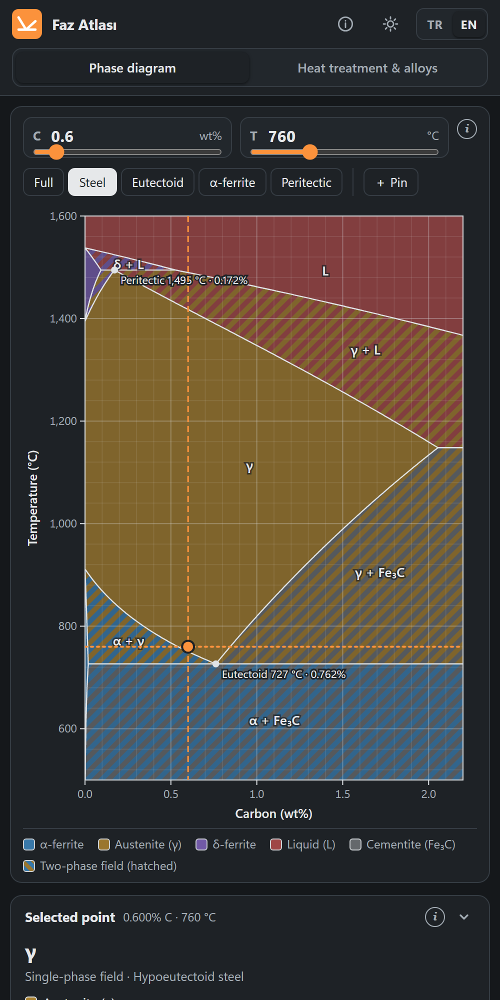

# Faz Atlası — a calculated Fe–C phase diagram for steels

**English** · [Türkçe](README.tr.md) · [Open the app](https://acarcemal.github.io/faz-atlasi/?lang=en)

The Fe–C diagram is used every day in foundries, heat-treatment shops, welding and the classroom — yet it is still mostly
read off a printed page with a ruler. Free online tools usually move an arrow over a static image, while software that actually
calculates phase equilibria (Thermo-Calc, JMatPro) is expensive. **Faz Atlası** ("phase atlas" in Turkish) tries to fill that gap.

**No images are used.** Every boundary is drawn from a thermodynamic equilibrium calculation (the CALPHAD method). The app is a
single web page in English and Turkish (**TR | EN** switch, top right), needs no installation and also works offline.



| Fe–C diagram | Built-in explanations | On a phone |
|---|---|---|
|  |  |  |

## Features

**Phase diagram**
- Calculated metastable Fe–Fe₃C diagram, 400–1600 °C.
- Pick a carbon content and temperature to see the phases present, their fractions from the lever rule and the carbon content of each phase.
- Critical temperatures for that carbon content (A1, A3, Acm, solidus, liquidus) and all field boundaries along the selected isotherm.
- Microstructure after slow cooling (proeutectoid phase, pearlite, ledeburite fractions).
- Pin points (Shift + click) and hover over them to compare.

**Heat treatment & alloys**
- Searchable library of **546 steels** — carbon, low-alloy, case-hardening, spring, bearing, tool and stainless (austenitic,
  martensitic, ferritic, duplex) — from EN/ISO standards and two open datasets. Search by any designation: EN, W.Nr., AISI/SAE, UNS,
  ASTM, JIS or GOST (42CrMo4, 1.7225, 4140, SCM440 and G41400 all find the same steel). You can enter and save your own compositions.
- **Calculated isopleths for 336 alloy families:** steels with close alloy content share one vertical section, with alloy carbides
  (M₇C₃, M₂₃C₆, M₆C, MC), σ, χ and Laves where they form, and three- and four-phase fields. Each steel's own critical temperatures are
  calculated and compared with its family's; a steel that differs by more than 5 °C gets a sub-family of its own, the rest are drawn
  shifted to the steel's own values.
- **Heat treatment by steel class:** transforming steels get Ae1/Ae3, carbide dissolution and hardening, normalizing, spheroidizing
  and stress-relieving windows; austenitic stainless steels get solution annealing, sensitization risk, σ, Ms (Eichelman–Hull) and
  Md30 (Angel) instead; duplex and ferritic grades have their own modes.
- Expected structure for each quench medium, Ms, retained austenite, as-quenched hardness and hardenability (D<sub>I</sub>).
- Every steel shows how well its class agrees with 746 measured Ac1/Ac3 temperatures (see *Validation*).
- Every card has an info window (i) that explains the underlying metallurgy.

## Try it

- **Online:** [acarcemal.github.io/faz-atlasi](https://acarcemal.github.io/faz-atlasi/?lang=en) — nothing to install, works on phones too.
- **Locally:** open `web/index.html` in a browser (double-click is enough; no server or internet needed), or serve it:

```bash
python -m http.server 8731 --directory web
```

- **With the calculation server (optional):** the web app also works with a FastAPI backend that calculates phase fractions at any
  clicked point and the heat-treatment regime of a typed-in composition. Without it, everything else comes from the static data files.
  Setup: [backend/README.md](backend/README.md).

## Is it safe to run?

Yes. Faz Atlası is just a web page:

- **No installation:** there is no `.exe` or anything to run. The `web/` folder contains only HTML, CSS, JavaScript and data files.
- **Sends nothing to anyone else:** no analytics, cookies, ads or third-party requests; it works offline. Opened from a web address,
  the page asks that same address once whether a calculation server is present (`/api/v1/health`); on GitHub Pages there is none and
  the app uses its static data files. Opened as a file, it makes no requests. Saved steels and pinned points stay in your own browser
  (localStorage).
- **Runs in the browser sandbox:** it cannot access your files or other programs.
- **You can verify it:** this command finds every network call in the web code. The matches are the SVG namespace
  (`http://www.w3.org/2000/svg`), the page's own address in the link-preview `<meta>` tags and `fetch` in `web/api.js`, which only
  talks to the page's own address (or a server you set yourself with `?api=`).

  ```bash
  grep -rnE "fetch\(|XMLHttpRequest|WebSocket|sendBeacon|https?://|eval\(" web --include=*.js --include=*.html
  ```

The Python scripts in `hesap/` are only needed to recalculate the data, not to use the app.

## How it is calculated

| Part | Method | Data / reference |
|---|---|---|
| Binary Fe–C diagram | Gibbs energy minimization with pycalphad | Fei & Brosh (2014), `cfe_broshe.tdb` |
| Alloy steel isopleths | pycalphad; alloy content fixed, 0–1.8 wt% C, 550–1100 °C; boundary tracing every 5 °C | MatCalc open steel database mc_fe v2.062 (TU Wien) |
| Alloy families | Steels within a composition tolerance share an isopleth; split into sub-families where a steel's own Ae1, Ae3 or carbide/σ dissolution differs by > 5 °C | Own CALPHAD calculation per steel |
| Heat-treatment regime | Ae1, Ae3, carbide dissolution, δ-ferrite, σ solvus of each steel's own composition (±2 °C); mode by steel class | MatCalc mc_fe; Eichelman & Hull (1953), Angel (1954) for austenitic stainless |
| Alloy shift of critical temperatures (compositions without an isopleth) | Calculated binary curves + alloy coefficients | Andrews (1965); eutectoid carbon shift from Bain |
| Ms, retained austenite | Empirical relations | Andrews (1965), Koistinen & Marburger (1959) |
| As-quenched hardness, hardenability | Empirical relations | Hodge & Orehoski (1946), ASTM A255 |

### Binary Fe–C: calculation vs. textbook values

| Point | Textbook | Calculated |
|---|---|---|
| Eutectoid | 727 °C, 0.76% C | 726.5 °C, 0.762% C |
| Eutectic | 1147 °C, 4.3% C | 1148.2 °C, 4.38% C (max. C in γ: 2.05%) |
| Peritectic | 1495 °C | 1494.6 °C |
| Pure Fe α→γ / γ→δ / melting | 912 / 1394 / 1538 °C | 911.6 / 1394.3 / 1537.8 °C |

The textbook values of 2.14% and 4.3% come from older experimental compilations; the calculation is based on a current
thermodynamic assessment.

### Alloy steels: calculation vs. literature

Calculated values are equilibrium (Ae) temperatures; measured Ac values are a few degrees higher because of the heating rate.

| Steel | Calculated | Literature (measured) | Empirical formulas only |
|---|---|---|---|
| C45 (1045) | Ae1 717 / Ae3 771 °C | Ac1 ~725 / Ac3 ~780 °C | 727 / 767 °C |
| 42CrMo4 (4140) | Ae1 727 / Ae3 771 °C | Ac1 ~730–745 / Ac3 ~780–790 °C | 744 / 766 °C |
| 16MnCr5 (5115) | Ae1 713 / Ae3 815 °C | Ac1 ~730–740 / Ac3 ~830 °C | — |
| 100Cr6 (52100) | Ae1 736 / Aecm 889 °C | Ac1 ~745 / Accm ~890–900 °C | 755 / 958 °C |

### Validation against 746 measurements

The calculated Ae1/Ae3 were compared with dilatometric Ac1/Ac3 measurements of 716 compositions from the Cambridge Materials
Algorithms Project ([MAP_DATA_AUSTENMAT](https://www.phase-trans.msm.cam.ac.uk/map/data/materials/austenmat-b.html); Gavard,
Bhadeshia, MacKay & Suzuki, *Mater. Sci. Technol.* 12 (1996) 453). Low-alloy steels, slow heating (≤ 1 K/s):

| Comparison | Measurements | Mean difference | Scatter (1σ) |
|---|---|---|---|
| Measured Ac3 − calculated Ae3 | 708 | +32 °C | 24 °C |
| Measured Ac1 − calculated Ae1 | 608 | +20 °C | 29 °C |
| Measured Ac3 − Andrews (1965) | 708 | +21 °C | 35 °C |

The positive difference is expected: the measurement is made while heating, the calculation is the equilibrium value. Stainless steels
are not covered by this dataset. Script: `backend/validate_measured.py` (the raw data is not redistributed here).

## Limitations

- All diagram values are **equilibrium** values; real heating and cooling deviate depending on rate (see *Validation*).
- N, Ti, Nb, Al, Co and B are not in the model yet; their effect is ignored (151 of 336 families contain at least one of them,
  mostly in trace amounts). Stainless results (σ, M₂₃C₆, δ-ferrite) have not been validated against measurements.
- 9 of the 546 steels have no calculated heat-treatment regime (7 stainless grades where the solver fails at a point, 2 records without
  carbon). The library is weighted towards AISI/ASTM and GOST datasets; only 75 grades come from EN/ISO standards.
- Predicted cooling structures are rough guides; use the steel's CCT diagram and supplier data for definitive results.
- Faz Atlası is intended for education and preliminary design. Temperatures used in production must be confirmed against the mill
  certificate and supplier data.

## Recalculating the data

The web app ships with precalculated data; the steps below are only needed to recalculate it or to add steels to the library.

```bash
python -m venv .venv
.venv/Scripts/python -m pip install pycalphad==0.11.2

# Binary Fe–C diagram -> web/veri/fe_c.js (~3 min)
.venv/Scripts/python hesap/diyagram_uret.py

# Adapt the MatCalc database for pycalphad (download mc_fe_v2062.tdb from matcalc.at)
.venv/Scripts/python hesap/tdb_temizle.py hesap/tdb/mc_fe_v2062.tdb hesap/tdb/mc_fe_pycalphad.tdb
.venv/Scripts/python hesap/celik_dogrula.py

# Steel library and isopleths (already calculated isopleths are skipped)
.venv/Scripts/python hesap/celik_kutuphanesi.py
KESIT_ISLEMCI=4 .venv/Scripts/python hesap/kesit_uret.py
```

`KESIT_ISLEMCI` is the number of parallel worker processes; each uses 1–1.5 GB of RAM. Steels with the same alloy content share one
isopleth (63 steels → 52 isopleths). To add a steel, add one line to `hesap/celik_kutuphanesi.py` and run the last two commands.

The 546-steel library, the 336 family isopleths and the static files the web app reads are produced by the backend
([backend/README.md](backend/README.md)); the two Mendeley datasets go into `hesap/veri_kaynaklari/` (links under *Credits*):

```bash
.venv/Scripts/python -m pip install -r backend/requirements.txt -r backend/requirements-api.txt
.venv/Scripts/python backend/build_db.py                                  # steel database
.venv/Scripts/python backend/trace_families.py --eksik --uyarlanir        # family isopleths (about a day on a laptop)
.venv/Scripts/python backend/split_families.py && .venv/Scripts/python backend/split_families.py --uygula   # sub-families
.venv/Scripts/python backend/trace_families.py --eksik --uyarlanir        # sub-family isopleths
.venv/Scripts/python backend/export_static.py --hesap 4                   # regimes + web/veri/kutuphane, web/veri/aile
```

The work can be shared between computers with `--parca` and merged with `backend/merge_isopleths.py`.

The MatCalc file does not load in pycalphad as is. `tdb_temizle.py` removes MatCalc-specific commands and kinetic parameters, fixes a
few typos in the source file (a missing `!`, `6000.00.00`, malformed reference tags) and filters out elements not used for steels.

The code and file names are in Turkish; the comments in each file explain what it does.

## Files

| File | Purpose |
|---|---|
| `web/index.html`, `web/style.css` | Page and design |
| `web/app.js` | Diagram drawing, point selection, binary Fe–C panel |
| `web/detay.js` | Heat-treatment mode: steel library, alloying, windows, cooling |
| `web/kesit.js` | Alloy steel isopleths (calculated), shift to the selected steel |
| `web/api.js` | Calculation server client; without a server the same requests are answered from `web/veri/kutuphane` and `web/veri/aile` |
| `backend/` | Steel database, alloy families, isopleth tracing, heat-treatment regimes, validation, FastAPI ([details](backend/README.md)) |
| `web/pin.js` | Pinned points and their cards |
| `web/bilgi.js`, `web/bilgi_en.js` | Info windows (TR / EN), card collapsing |
| `web/dil.js`, `web/dil_sec.js` | Language system: all interface text (TR / EN), TR \| EN switch |
| `hesap/diyagram_uret.py` | Binary Fe–C data |
| `hesap/celik_kutuphanesi.py` | Steel library (single source) |
| `hesap/tdb_temizle.py`, `celik_dogrula.py`, `kesit_uret.py` | MatCalc database preparation, validation, isopleth generation |
| `hesap/gorsel_uret.ps1`, `gorsel_senaryo.js` | Generates the README / sharing screenshots (TR + EN) |

## Credits and licenses

- **pycalphad** — R. Otis & Z.-K. Liu, *J. Open Res. Softw.* 5 (2017) 1. MIT license.
- **Fe–C database** — Fei & Brosh (2014), `cfe_broshe.tdb`, shipped with pycalphad.
- **MatCalc mc_fe v2.062** — E. Povoden-Karadeniz, A. Jacob, TU Wien. Published under the
  [Open Database License (ODbL)](https://opendatacommons.org/licenses/odbl/1-0/). The alloy steel isopleths in this project are produced
  from this database. If the adapted database file (`mc_fe_pycalphad.tdb`) is shared, it must be shared under the same license with this
  attribution.
- Steel composition ranges are the heat-analysis ranges from the relevant EN/ISO standards. Further compositions and designations:
  Mendeley Data, "A database of mechanical properties of steels" ([10.17632/jmwb9ddd43.1](https://doi.org/10.17632/jmwb9ddd43.1)) and
  "Steel classification database" ([10.17632/mfhvdv4b8z.1](https://doi.org/10.17632/mfhvdv4b8z.1)).
- **Validation data** — MAP_DATA_AUSTENMAT, L. Gavard, H.K.D.H. Bhadeshia, D.J.C. MacKay, S. Suzuki, *Mater. Sci. Technol.* 12 (1996)
  453–463, University of Cambridge; used for comparison only.

Faz Atlası code is released under the [MIT License](LICENSE); the data notice for the isopleths is in [NOTICE](NOTICE).
