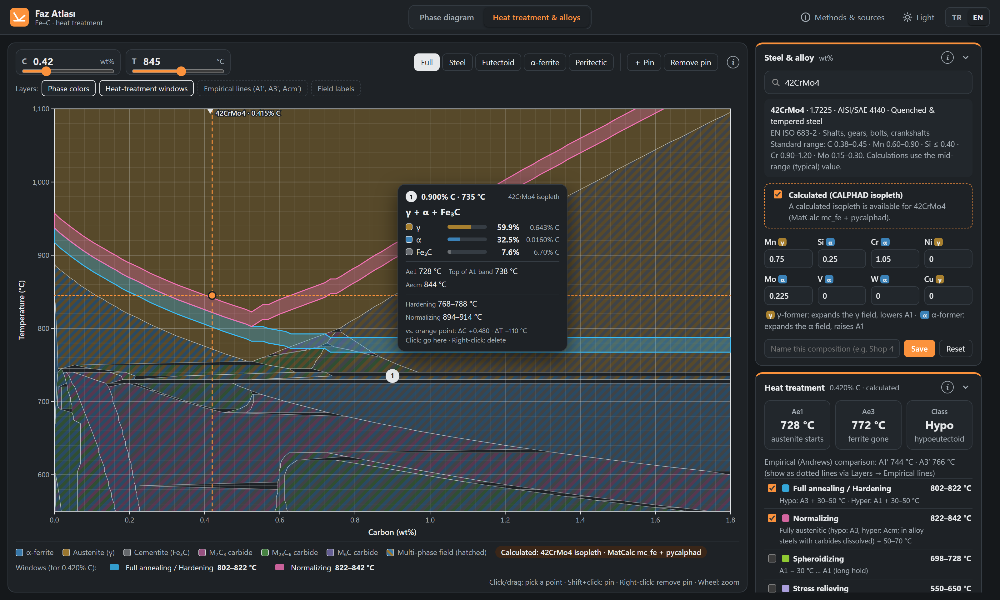
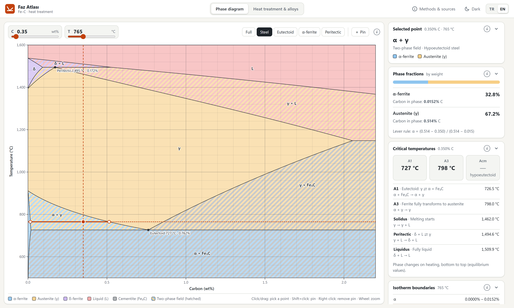
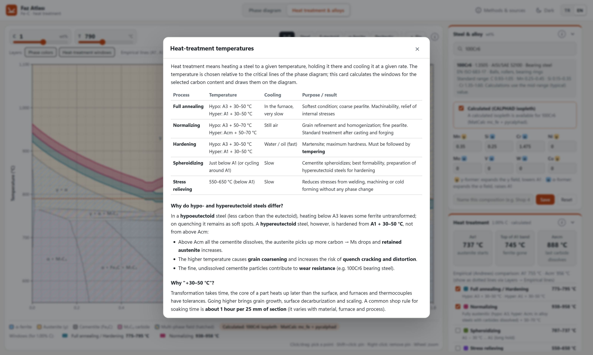
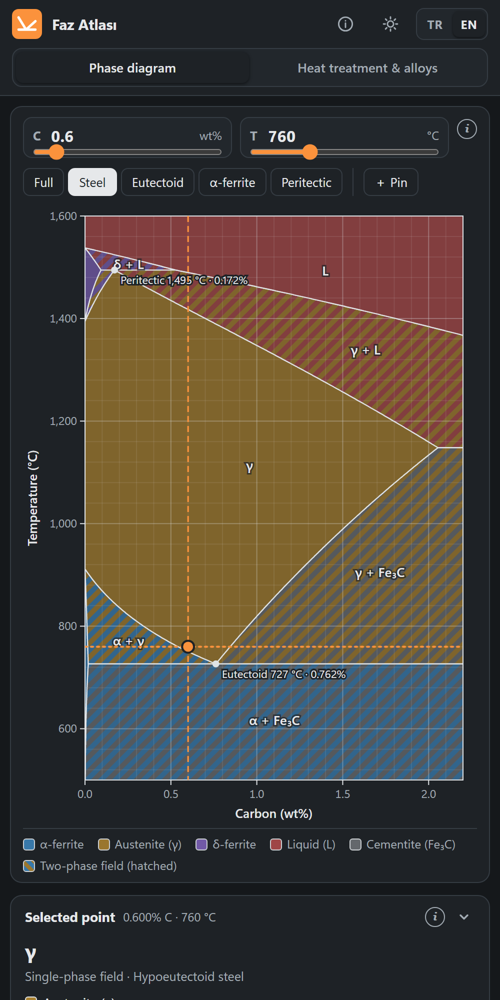

# Faz Atlası — a calculated Fe–C phase diagram for steels

**English** · [Türkçe](README.tr.md) · [Open the app](https://acarcemal.github.io/faz-atlasi/?lang=en)

The Fe–C diagram is used every day in foundries, heat-treatment shops, welding and the classroom — yet it is still mostly
read off a printed page with a ruler. Free online tools usually move an arrow over a static image, while software that actually
calculates phase equilibria (Thermo-Calc, JMatPro) is expensive. **Faz Atlası** ("phase atlas" in Turkish) tries to fill that gap.

**No images are used.** Every boundary is drawn from a thermodynamic equilibrium calculation (the CALPHAD method). The app is a
single web page in English and Turkish (**TR | EN** switch, top right), needs no installation and also works offline.



| Fe–C diagram | Built-in explanations | On a phone |
|---|---|---|
|  |  |  |

## Features

**Phase diagram**
- Calculated metastable Fe–Fe₃C diagram, 400–1600 °C.
- Pick a carbon content and temperature to see the phases present, their fractions from the lever rule and the carbon content of each phase.
- Critical temperatures for that carbon content (A1, A3, Acm, solidus, liquidus) and all field boundaries along the selected isotherm.
- Microstructure after slow cooling (proeutectoid phase, pearlite, ledeburite fractions).
- Pin points (Shift + click) and hover over them to compare.

**Heat treatment & alloys**
- Searchable library of 63 low-alloy steels: EN/ISO grade and number, AISI/SAE equivalent, standard composition ranges.
  You can enter and save your own compositions.
- **Calculated isopleths:** the vertical section of the selected steel, with alloy carbides (M₇C₃, M₂₃C₆, M₆C, MC) and three- and
  four-phase fields — showing A1 as a band and the temperature at which each carbide dissolves.
- Full annealing / hardening, normalizing, spheroidizing and stress-relieving windows drawn on the diagram.
- Expected structure for each quench medium, Ms, retained austenite, as-quenched hardness and hardenability (D<sub>I</sub>).
- Every card has an info window (i) that explains the underlying metallurgy.

## Try it

- **Online:** [acarcemal.github.io/faz-atlasi](https://acarcemal.github.io/faz-atlasi/?lang=en) — nothing to install, works on phones too.
- **Locally:** open `web/index.html` in a browser (double-click is enough; no server or internet needed), or serve it:

```bash
python -m http.server 8731 --directory web
```

## Is it safe to run?

Yes. Faz Atlası is just a web page:

- **No installation:** there is no `.exe` or anything to run. The `web/` folder contains only HTML, CSS, JavaScript and data files.
- **Sends nothing anywhere:** no analytics, cookies, ads or external requests; it works offline. Saved steels and pinned points
  stay in your own browser (localStorage).
- **Runs in the browser sandbox:** it cannot access your files or other programs.
- **You can verify it:** this command finds every network call in the web code. The only matches are the SVG namespace
  (`http://www.w3.org/2000/svg`) and the page's own address in the link-preview `<meta>` tags — neither is a request.

  ```bash
  grep -rnE "fetch\(|XMLHttpRequest|WebSocket|sendBeacon|https?://|eval\(" web --include=*.js --include=*.html
  ```

The Python scripts in `hesap/` are only needed to recalculate the data, not to use the app.

## How it is calculated

| Part | Method | Data / reference |
|---|---|---|
| Binary Fe–C diagram | Gibbs energy minimization with pycalphad | Fei & Brosh (2014), `cfe_broshe.tdb` |
| Alloy steel isopleths | pycalphad; alloy content fixed, 0–1.8 wt% C, 550–1100 °C | MatCalc open steel database mc_fe v2.062 (TU Wien) |
| Alloy shift of critical temperatures (compositions without an isopleth) | Calculated binary curves + alloy coefficients | Andrews (1965); eutectoid carbon shift from Bain |
| Ms, retained austenite | Empirical relations | Andrews (1965), Koistinen & Marburger (1959) |
| As-quenched hardness, hardenability | Empirical relations | Hodge & Orehoski (1946), ASTM A255 |

### Binary Fe–C: calculation vs. textbook values

| Point | Textbook | Calculated |
|---|---|---|
| Eutectoid | 727 °C, 0.76% C | 726.5 °C, 0.762% C |
| Eutectic | 1147 °C, 4.3% C | 1148.2 °C, 4.38% C (max. C in γ: 2.05%) |
| Peritectic | 1495 °C | 1494.6 °C |
| Pure Fe α→γ / γ→δ / melting | 912 / 1394 / 1538 °C | 911.6 / 1394.3 / 1537.8 °C |

The textbook values of 2.14% and 4.3% come from older experimental compilations; the calculation is based on a current
thermodynamic assessment.

### Alloy steels: calculation vs. literature

Calculated values are equilibrium (Ae) temperatures; measured Ac values are a few degrees higher because of the heating rate.

| Steel | Calculated | Literature (measured) | Empirical formulas only |
|---|---|---|---|
| C45 (1045) | Ae1 717 / Ae3 771 °C | Ac1 ~725 / Ac3 ~780 °C | 727 / 767 °C |
| 42CrMo4 (4140) | Ae1 727 / Ae3 771 °C | Ac1 ~730–745 / Ac3 ~780–790 °C | 744 / 766 °C |
| 16MnCr5 (5115) | Ae1 713 / Ae3 815 °C | Ac1 ~730–740 / Ac3 ~830 °C | — |
| 100Cr6 (52100) | Ae1 736 / Aecm 889 °C | Ac1 ~745 / Accm ~890–900 °C | 755 / 958 °C |

## Limitations

- All diagram values are **equilibrium** values; real heating and cooling deviate depending on rate.
- Stainless and high-alloy tool steels (sigma and Laves phases; N, Nb, Ti, Al, B) are not covered yet.
- Predicted cooling structures are rough guides; use the steel's CCT diagram and supplier data for definitive results.
- Faz Atlası is intended for education and preliminary design. Temperatures used in production must be confirmed against the mill
  certificate and supplier data.

## Recalculating the data

The web app ships with precalculated data; the steps below are only needed to recalculate it or to add steels to the library.

```bash
python -m venv .venv
.venv/Scripts/python -m pip install pycalphad==0.11.2

# Binary Fe–C diagram -> web/veri/fe_c.js (~3 min)
.venv/Scripts/python hesap/diyagram_uret.py

# Adapt the MatCalc database for pycalphad (download mc_fe_v2062.tdb from matcalc.at)
.venv/Scripts/python hesap/tdb_temizle.py hesap/tdb/mc_fe_v2062.tdb hesap/tdb/mc_fe_pycalphad.tdb
.venv/Scripts/python hesap/celik_dogrula.py

# Steel library and isopleths (already calculated isopleths are skipped)
.venv/Scripts/python hesap/celik_kutuphanesi.py
KESIT_ISLEMCI=4 .venv/Scripts/python hesap/kesit_uret.py
```

`KESIT_ISLEMCI` is the number of parallel worker processes; each uses 1–1.5 GB of RAM. Steels with the same alloy content share one
isopleth (63 steels → 52 isopleths). To add a steel, add one line to `hesap/celik_kutuphanesi.py` and run the last two commands.

The MatCalc file does not load in pycalphad as is. `tdb_temizle.py` removes MatCalc-specific commands and kinetic parameters, fixes a
few typos in the source file (a missing `!`, `6000.00.00`, malformed reference tags) and filters out elements not used for steels.

The code and file names are in Turkish; the comments in each file explain what it does.

## Files

| File | Purpose |
|---|---|
| `web/index.html`, `web/style.css` | Page and design |
| `web/app.js` | Diagram drawing, point selection, binary Fe–C panel |
| `web/detay.js` | Heat-treatment mode: steel library, alloying, windows, cooling |
| `web/kesit.js` | Alloy steel isopleths (calculated) |
| `web/pin.js` | Pinned points and their cards |
| `web/bilgi.js`, `web/bilgi_en.js` | Info windows (TR / EN), card collapsing |
| `web/dil.js`, `web/dil_sec.js` | Language system: all interface text (TR / EN), TR \| EN switch |
| `hesap/diyagram_uret.py` | Binary Fe–C data |
| `hesap/celik_kutuphanesi.py` | Steel library (single source) |
| `hesap/tdb_temizle.py`, `celik_dogrula.py`, `kesit_uret.py` | MatCalc database preparation, validation, isopleth generation |
| `hesap/gorsel_uret.ps1`, `gorsel_senaryo.js` | Generates the README / sharing screenshots (TR + EN) |

## Credits and licenses

- **pycalphad** — R. Otis & Z.-K. Liu, *J. Open Res. Softw.* 5 (2017) 1. MIT license.
- **Fe–C database** — Fei & Brosh (2014), `cfe_broshe.tdb`, shipped with pycalphad.
- **MatCalc mc_fe v2.062** — E. Povoden-Karadeniz, A. Jacob, TU Wien. Published under the
  [Open Database License (ODbL)](https://opendatacommons.org/licenses/odbl/1-0/). The alloy steel isopleths in this project are produced
  from this database. If the adapted database file (`mc_fe_pycalphad.tdb`) is shared, it must be shared under the same license with this
  attribution.
- Steel composition ranges are the heat-analysis ranges from the relevant EN/ISO standards.
