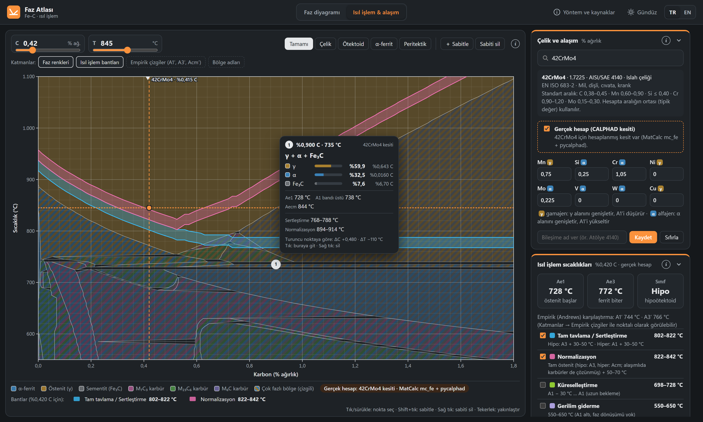
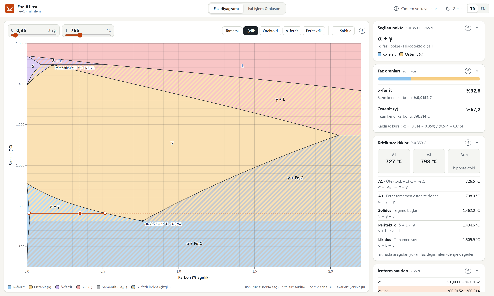
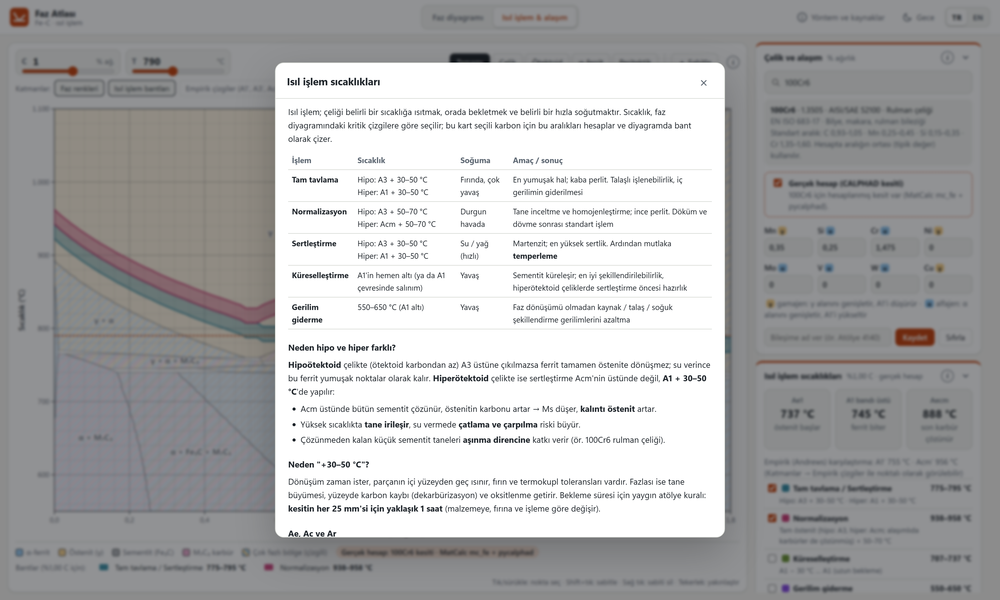
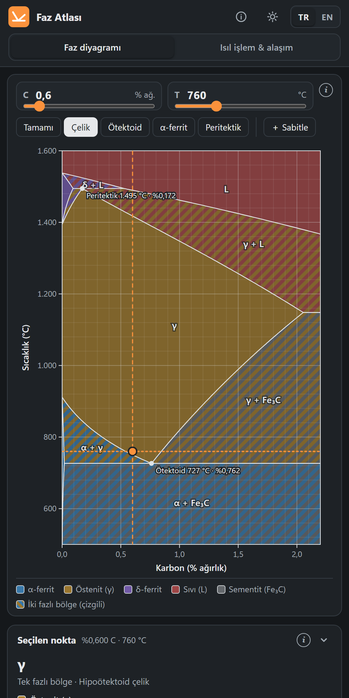

# Faz Atlası — Fe–C ve çelikler için hesaplanmış faz diyagramı

[English](README.md) · **Türkçe** · [Uygulamayı aç](https://acarcemal.github.io/faz-atlasi/)

Fe–C diyagramı sektörde (döküm, ısıl işlem, kaynak) ve derslerde her gün kullanılıyor ama hâlâ çoğunlukla kâğıt ve cetvelle
okunuyor. Ücretsiz çevrimiçi araçlar genelde bir resmin üstünde ok gezdiriyor. Thermo-Calc, JMatPro gibi hesap yapan
programlar ise çok pahalı. **Faz Atlası** ikisinin arasındaki boşluğu doldurmaya çalışıyor.

**Hiçbir resim kullanılmaz.** Her sınır, termodinamik dengenin (CALPHAD yöntemi) bilgisayarda hesaplanmasından çizilir.
Uygulama Türkçe ve İngilizcedir (sağ üstteki **TR | EN**), tek bir web sayfasıdır, internetsiz de çalışır.



| Fe–C diyagramı | Bilgi pencereleri | Telefonda |
|---|---|---|
|  |  |  |

## Neler yapabiliyor?

**Faz diyagramı**
- Hesaplanmış metastabil Fe–Fe₃C diyagramı (400–1600 °C).
- Karbon ve sıcaklık seçilince o noktadaki fazlar, kaldıraç kuralıyla faz oranları ve her fazın kendi karbonu görünür.
- O karbon için A1, A3, Acm, solidus ve likidus listelenir; seçilen sıcaklıktaki bütün bölge sınırları gösterilir.
- Yavaş soğuma sonrası mikroyapı (proötektoid faz, perlit, ledeburit oranları) hesaplanır.
- Noktalar sabitlenip (Shift + tık) üstüne gelinerek karşılaştırılabilir.

**Isıl işlem ve alaşım**
- **546 çeliklik** aranabilir kütüphane: karbon, düşük alaşımlı, sementasyon, yay, rulman, takım ve paslanmaz (östenitik,
  martenzitik, ferritik, dupleks) çelikler; EN/ISO standartları ve iki açık veri setinden. Her normla aranır: EN, W.Nr., AISI/SAE,
  UNS, ASTM, JIS, GOST (42CrMo4, 1.7225, 4140, SCM440 ve G41400 aynı çeliği bulur). Kullanıcı kendi bileşimini girip kaydedebilir.
- **336 alaşım ailesinin hesaplanmış kesiti:** Alaşımı birbirine yakın çelikler aynı dikey kesiti paylaşır; karbürler (M₇C₃,
  M₂₃C₆, M₆C, MC), oluştuğu yerde σ, χ ve Laves, üç–dört fazlı bölgeler görünür. Her çeliğin kendi kritik sıcaklıkları ayrıca
  hesaplanıp ailesininkilerle karşılaştırılır: 5 °C'den fazla sapan çelik kendi alt ailesine ayrılır, kalanlarda çizgiler çeliğin
  kendi değerlerine kaydırılarak çizilir.
- **Çelik sınıfına göre ısıl işlem:** Dönüşümlü çeliklerde Ae1/Ae3, karbür çözünmesi ve tam tavlama / sertleştirme, normalizasyon,
  küreselleştirme, gerilim giderme bantları; östenitik paslanmazda bunların yerine çözeltiye alma, hassaslaşma riski, σ, Ms
  (Eichelman–Hull) ve Md30 (Angel); dupleks ve ferritik paslanmazların kendi modları vardır.
- Soğuma ortamına göre beklenen yapı, Ms, kalıntı östenit, martenzit sertliği ve sertleşebilirlik (D<sub>I</sub>) hesaplanır.
- Her çelikte, sınıfının 746 ölçülmüş Ac1/Ac3 değerine ne kadar uyduğu yazar (*Doğrulama* bölümü).
- Her kartta, konuyu terim terim anlatan bir bilgi penceresi (i) vardır.

## Açmak

- **İnternetten:** [acarcemal.github.io/faz-atlasi](https://acarcemal.github.io/faz-atlasi/) — kurulum yok, telefonda da açılır.
  İngilizce açmak için adresin sonuna `?lang=en` ekle.
- **Kendi bilgisayarından:** `web/index.html` dosyasına çift tıklaman yeterli; sunucu ya da internet gerekmez. Yerel bir sunucuyla açmak istersen:

```bash
python -m http.server 8731 --directory web
```

- **Hesap sunucusuyla (isteğe bağlı):** Sayfa bir FastAPI sunucusuyla da çalışır; o zaman tıklanan her noktanın faz oranları ve
  elle girilen bileşimin ısıl işlem rejimi anlık hesaplanır. Sunucu yoksa geri kalan her şey statik veri dosyalarından gelir.
  Kurulum: [backend/README.tr.md](backend/README.tr.md).

## Güvenli mi?

Evet. Faz Atlası yalnızca bir web sayfasıdır:

- **Kurulum yoktur:** `.exe` ya da çalıştırılacak bir program yoktur. `web/` klasöründe sadece HTML, CSS, JavaScript ve
  veri dosyaları (`web/veri/`) bulunur.
- **Başka kimseye bir şey göndermez:** Analitik, çerez, reklam ya da üçüncü taraf bağlantısı yoktur; sayfa internetsiz çalışır.
  Bir web adresinden açıldığında, aynı adrese bir kez hesap sunucusu olup olmadığını sorar (`/api/v1/health`); GitHub Pages'te
  sunucu yoktur ve sayfa statik veri dosyalarını kullanır. Dosya olarak açıldığında hiç istek yapmaz. Kaydettiğin çelikler ve
  sabitlediğin noktalar yalnızca kendi tarayıcında (localStorage) saklanır.
- **Tarayıcının korumalı alanında çalışır:** Bilgisayarındaki dosyalara ya da başka programlara erişemez.
- **İndirmeden de deneyebilirsin:** GitHub Pages bağlantısından açtığında bilgisayarına hiçbir dosya inmez.
- **Kod açıktır, kendin doğrulayabilirsin:** Web klasöründeki bütün ağ isteklerini şu komutla görebilirsin. Sonuçta SVG ad alanı
  (`http://www.w3.org/2000/svg`), bağlantı önizlemesi için `<meta>` etiketlerindeki sayfanın kendi adresi ve `web/api.js`'teki
  `fetch` çıkar; o da yalnızca sayfanın kendi adresine (ya da `?api=` ile senin verdiğin sunucuya) bağlanır.

  ```bash
  grep -rnE "fetch\(|XMLHttpRequest|WebSocket|sendBeacon|https?://|eval\(" web --include=*.js --include=*.html
  ```

`hesap/` klasöründeki Python scriptleri sayfayı kullanmak için gerekli değildir; yalnızca verileri baştan hesaplamak
isteyenler içindir.

## Nasıl hesaplanıyor?

| Bölüm | Yöntem | Veri / kaynak |
|---|---|---|
| İkili Fe–C diyagramı | pycalphad ile Gibbs enerjisi minimizasyonu | Fei & Brosh (2014), `cfe_broshe.tdb` |
| Alaşımlı çelik kesitleri | pycalphad, alaşım sabit, C 0–%1,8, 550–1100 °C; 5 °C'de bir sınır izleme | MatCalc açık çelik veritabanı mc_fe v2.062 (TU Wien) |
| Alaşım aileleri | Bileşim toleransı içindeki çelikler kesiti paylaşır; kendi Ae1, Ae3 ya da karbür/σ çözünmesi 5 °C'den fazla sapan çelik alt aileye ayrılır | Her çelik için ayrı CALPHAD hesabı |
| Isıl işlem rejimi | Çeliğin kendi bileşiminde Ae1, Ae3, karbür çözünme, δ-ferrit, σ çözünme (±2 °C); mod çelik sınıfına göre | MatCalc mc_fe; östenitik paslanmazda Eichelman & Hull (1953), Angel (1954) |
| Alaşımın kritik sıcaklıklara etkisi (hesap olmayan bileşimler) | Hesaplanan ikili eğriler + alaşım katsayıları | Andrews (1965); ötektoid C kayması Bain |
| Ms, kalıntı östenit | Empirik bağıntılar | Andrews (1965), Koistinen & Marburger (1959) |
| Martenzit sertliği, sertleşebilirlik | Empirik bağıntılar | Hodge & Orehoski (1946), ASTM A255 |

### İkili Fe–C: hesap ve ders kitabı karşılaştırması

| Nokta | Ders kitabı | Hesap |
|---|---|---|
| Ötektoid | 727 °C, %0,76 C | 726,5 °C, %0,762 C |
| Ötektik | 1147 °C, %4,3 C | 1148,2 °C, %4,38 C (γ'nın en fazla C'si %2,05) |
| Peritektik | 1495 °C | 1494,6 °C |
| Saf Fe α→γ / γ→δ / ergime | 912 / 1394 / 1538 °C | 911,6 / 1394,3 / 1537,8 °C |

Kitaplardaki %2,14 ve %4,3 değerleri eski deneysel derlemelerdir. Hesap, güncel termodinamik değerlendirmeye dayanır.

### Alaşımlı çelikler: hesap ve literatür karşılaştırması

Hesaplananlar denge (Ae) değerleridir; ölçülen Ac değerleri ısıtma hızı nedeniyle birkaç derece daha yüksektir.

| Çelik | Hesap | Literatür (ölçülen) | Yalnızca formülle |
|---|---|---|---|
| C45 | Ae1 717 / Ae3 771 °C | Ac1 ~725 / Ac3 ~780 °C | 727 / 767 °C |
| 42CrMo4 | Ae1 727 / Ae3 771 °C | Ac1 ~730–745 / Ac3 ~780–790 °C | 744 / 766 °C |
| 16MnCr5 | Ae1 713 / Ae3 815 °C | Ac1 ~730–740 / Ac3 ~830 °C | — |
| 100Cr6 | Ae1 736 / Aecm 889 °C | Ac1 ~745 / Accm ~890–900 °C | 755 / 958 °C |

### Doğrulama: 746 ölçümle karşılaştırma

Hesaplanan Ae1/Ae3 değerleri, Cambridge Materials Algorithms Project'teki 716 bileşimin dilatometriyle ölçülmüş Ac1/Ac3 değerleriyle
karşılaştırıldı ([MAP_DATA_AUSTENMAT](https://www.phase-trans.msm.cam.ac.uk/map/data/materials/austenmat-b.html); Gavard,
Bhadeshia, MacKay & Suzuki, *Mater. Sci. Technol.* 12 (1996) 453). Düşük alaşımlı çelikler, yavaş ısıtma (≤ 1 K/s):

| Karşılaştırma | Ölçüm | Ortalama fark | Dağılım (1σ) |
|---|---|---|---|
| Ölçülen Ac3 − hesaplanan Ae3 | 708 | +32 °C | 24 °C |
| Ölçülen Ac1 − hesaplanan Ae1 | 608 | +20 °C | 29 °C |
| Ölçülen Ac3 − Andrews (1965) | 708 | +21 °C | 35 °C |

Pozitif fark beklenen yönde: ölçüm ısıtırken yapılıyor, hesap denge değeri. Bu veri seti paslanmazları kapsamıyor.
Betik: `backend/validate_measured.py` (ham veri burada yeniden dağıtılmıyor).

## Sınırlar

- Bütün diyagram değerleri **denge** değerleridir; gerçek ısıtma ve soğutmada hıza bağlı sapma olur (*Doğrulama* bölümü).
- N, Ti, Nb, Al, Co ve B henüz modelde yok; etkileri ihmal ediliyor (336 ailenin 151'i bunlardan en az birini, çoğunlukla eser
  miktarda içeriyor). Paslanmaz sonuçları (σ, M₂₃C₆, δ-ferrit) ölçümle doğrulanmadı.
- 546 çeliğin 9'unda ısıl işlem rejimi hesaplanamadı (7 paslanmazda çözücü bir noktada sonuç bulamıyor, 2 kayıtta karbon yok).
  Kütüphane AISI/ASTM ve GOST veri setlerine ağırlıklı; EN/ISO standartlarından gelen sadece 75 kalite var.
- Soğuma yapısı tahminleri kabadır; kesin sonuç için çeliğin CCT diyagramı ve üretici veri sayfası esastır.
- Faz Atlası eğitim ve ön tasarım içindir. Üretimde kullanılacak sıcaklıklar malzeme sertifikası ve üretici verisiyle doğrulanmalıdır.

## Veriyi yeniden üretmek

Web sayfası hazır verilerle gelir; aşağıdakiler yalnızca veriyi baştan hesaplamak ya da kütüphaneye çelik eklemek içindir.

```bash
python -m venv .venv
.venv/Scripts/python -m pip install pycalphad==0.11.2

# İkili Fe–C diyagramı -> web/veri/fe_c.js (~3 dk)
.venv/Scripts/python hesap/diyagram_uret.py

# MatCalc veritabanını pycalphad'a uyarla (mc_fe_v2062.tdb, matcalc.at'tan indirilir)
.venv/Scripts/python hesap/tdb_temizle.py hesap/tdb/mc_fe_v2062.tdb hesap/tdb/mc_fe_pycalphad.tdb
.venv/Scripts/python hesap/celik_dogrula.py

# Çelik kütüphanesi ve kesitler (hesaplanmış kesitler atlanır, kaldığı yerden devam eder)
.venv/Scripts/python hesap/celik_kutuphanesi.py
KESIT_ISLEMCI=4 .venv/Scripts/python hesap/kesit_uret.py
```

`KESIT_ISLEMCI` paralel işlem sayısıdır; her işlem 1–1,5 GB RAM kullanır. Aynı alaşımı paylaşan çelikler tek kesiti
kullanır (63 çelik → 52 kesit). Yeni çelik eklemek için `hesap/celik_kutuphanesi.py`'ye bir satır ekleyip son iki komutu çalıştırman yeterli.

546 çeliklik kütüphaneyi, 336 aile kesitini ve sayfanın okuduğu statik dosyaları backend üretir
([backend/README.tr.md](backend/README.tr.md)); iki Mendeley veri seti `hesap/veri_kaynaklari/` klasörüne konur (bağlantılar *Atıflar*'da):

```bash
.venv/Scripts/python -m pip install -r backend/requirements.txt -r backend/requirements-api.txt
.venv/Scripts/python backend/build_db.py                                  # çelik veritabanı
.venv/Scripts/python backend/trace_families.py --eksik --uyarlanir        # aile kesitleri (dizüstüde yaklaşık bir gün)
.venv/Scripts/python backend/split_families.py && .venv/Scripts/python backend/split_families.py --uygula   # alt aileler
.venv/Scripts/python backend/trace_families.py --eksik --uyarlanir        # alt aile kesitleri
.venv/Scripts/python backend/export_static.py --hesap 4                   # rejimler + web/veri/kutuphane, web/veri/aile
```

Hesap `--parca` ile birden çok bilgisayara bölüşülebilir, sonuçlar `backend/merge_isopleths.py` ile birleştirilir.

MatCalc dosyası pycalphad'a doğrudan uymuyor. `tdb_temizle.py` şunları yapar: MatCalc'a özgü komutları ve kinetik
parametreleri temizler, kaynaktaki birkaç yazım hatasını (eksik `!`, `6000.00.00`, bozuk kaynakça etiketleri) düzeltir
ve çelik dışı elementleri ayıklar.

## Dosyalar

| Dosya | Görev |
|---|---|
| `web/index.html`, `web/style.css` | Sayfa ve tasarım |
| `web/app.js` | Diyagram çizimi, nokta seçimi, ikili Fe–C paneli |
| `web/detay.js` | Isıl işlem modu: çelik kütüphanesi, alaşım, bantlar, soğuma |
| `web/kesit.js` | Alaşımlı çelik kesitleri (gerçek hesap), seçilen çeliğe göre kaydırma |
| `web/api.js` | Hesap sunucusu istemcisi; sunucu yoksa aynı istekler `web/veri/kutuphane` ve `web/veri/aile` dosyalarından karşılanır |
| `backend/` | Çelik veritabanı, alaşım aileleri, kesit izleme, ısıl işlem rejimleri, doğrulama, FastAPI ([ayrıntılar](backend/README.tr.md)) |
| `web/pin.js` | Sabitlenen noktalar ve bilgi kartı |
| `web/bilgi.js`, `web/bilgi_en.js` | Bilgi (i) pencereleri (TR / EN), kart katlama |
| `web/dil.js`, `web/dil_sec.js` | Dil sistemi: bütün arayüz metinleri (TR / EN), TR \| EN seçici |
| `hesap/diyagram_uret.py` | İkili Fe–C verisi |
| `hesap/celik_kutuphanesi.py` | Çelik kütüphanesi (tek kaynak) |
| `hesap/tdb_temizle.py`, `celik_dogrula.py`, `kesit_uret.py` | MatCalc veritabanı hazırlama, doğrulama, kesit üretimi |
| `hesap/gorsel_uret.ps1`, `gorsel_senaryo.js` | README ve paylaşım görsellerini (TR + EN) üretir |

## Atıflar ve lisanslar

- **pycalphad** — R. Otis & Z.-K. Liu, *J. Open Res. Softw.* 5 (2017) 1. MIT lisansı.
- **Fe–C veritabanı** — Fei & Brosh (2014), pycalphad ile birlikte gelen `cfe_broshe.tdb`.
- **MatCalc mc_fe v2.062** — E. Povoden-Karadeniz, A. Jacob, TU Wien. [Open Database License (ODbL)](https://opendatacommons.org/licenses/odbl/1-0/)
  ile yayımlanmıştır. Bu projedeki alaşımlı çelik kesitleri bu veritabanından üretilmiştir. Uyarlanmış veritabanı dosyası
  (`mc_fe_pycalphad.tdb`) paylaşılırsa ODbL gereği aynı lisansla ve bu atıfla paylaşılmalıdır.
- Çelik bileşim aralıkları ilgili EN/ISO standartlarındaki döküm analizi aralıklarıdır. Ek bileşim ve norm adları: Mendeley Data,
  "A database of mechanical properties of steels" ([10.17632/jmwb9ddd43.1](https://doi.org/10.17632/jmwb9ddd43.1)) ve "Steel
  classification database" ([10.17632/mfhvdv4b8z.1](https://doi.org/10.17632/mfhvdv4b8z.1)).
- **Doğrulama verisi** — MAP_DATA_AUSTENMAT, L. Gavard, H.K.D.H. Bhadeshia, D.J.C. MacKay, S. Suzuki, *Mater. Sci. Technol.* 12 (1996)
  453–463, Cambridge Üniversitesi; sadece karşılaştırma için kullanıldı.


Faz Atlası kodu [MIT lisansı](LICENSE) ile yayımlanmıştır; kesit verilerine ait veri notu [NOTICE](NOTICE) dosyasındadır.
