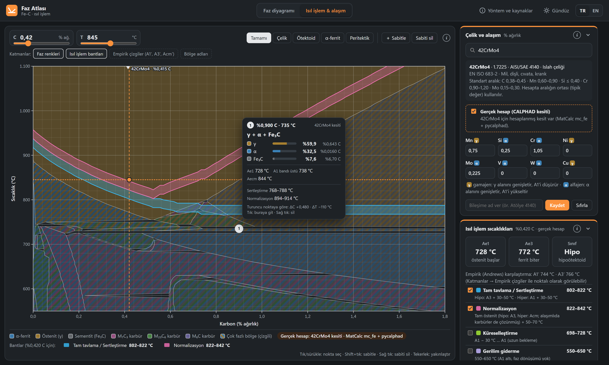
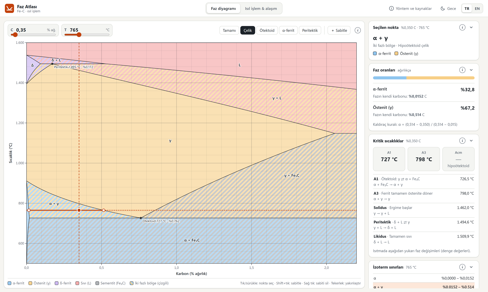
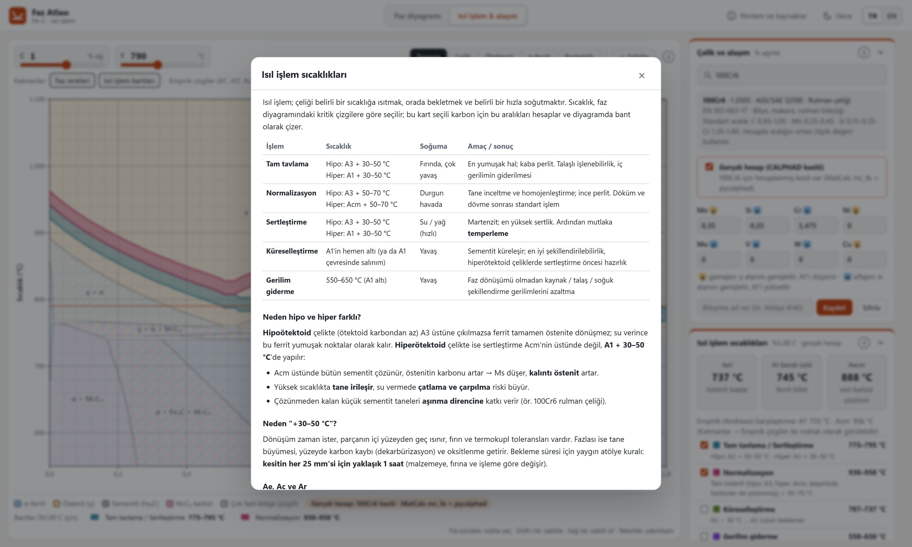
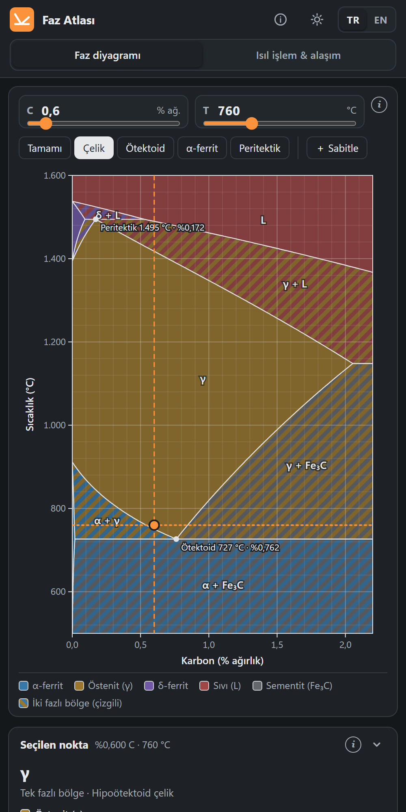

# Faz Atlası — Fe–C ve çelikler için hesaplanmış faz diyagramı

[English](README.md) · **Türkçe** · [Uygulamayı aç](https://acarcemal.github.io/faz-atlasi/)

Fe–C diyagramı sektörde (döküm, ısıl işlem, kaynak) ve derslerde her gün kullanılıyor ama hâlâ çoğunlukla kâğıt ve cetvelle
okunuyor. Ücretsiz çevrimiçi araçlar genelde bir resmin üstünde ok gezdiriyor. Thermo-Calc, JMatPro gibi hesap yapan
programlar ise çok pahalı. **Faz Atlası** ikisinin arasındaki boşluğu doldurmaya çalışıyor.

**Hiçbir resim kullanılmaz.** Her sınır, termodinamik dengenin (CALPHAD yöntemi) bilgisayarda hesaplanmasından çizilir.
Uygulama Türkçe ve İngilizcedir (sağ üstteki **TR | EN**), tek bir web sayfasıdır, internetsiz de çalışır.



| Fe–C diyagramı | Bilgi pencereleri | Telefonda |
|---|---|---|
|  |  |  |

## Neler yapabiliyor?

**Faz diyagramı**
- Hesaplanmış metastabil Fe–Fe₃C diyagramı (400–1600 °C).
- Karbon ve sıcaklık seçilince o noktadaki fazlar, kaldıraç kuralıyla faz oranları ve her fazın kendi karbonu görünür.
- O karbon için A1, A3, Acm, solidus ve likidus listelenir; seçilen sıcaklıktaki bütün bölge sınırları gösterilir.
- Yavaş soğuma sonrası mikroyapı (proötektoid faz, perlit, ledeburit oranları) hesaplanır.
- Noktalar sabitlenip (Shift + tık) üstüne gelinerek karşılaştırılabilir.

**Isıl işlem ve alaşım**
- 63 düşük alaşımlı çelikten oluşan aranabilir kütüphane: EN/ISO adı ve numarası, AISI/SAE karşılığı, standart bileşim
  aralıkları. Kullanıcı kendi bileşimini girip kaydedebilir.
- **Gerçek hesap:** Seçilen çeliğin alaşımlı dikey kesiti (izoplet) gösterilir. Karbürler (M₇C₃, M₂₃C₆, M₆C, MC) ve
  üç–dört fazlı bölgeler görünür; A1'in bir bant olduğu, karbürlerin hangi sıcaklıkta çözündüğü okunur.
- Tam tavlama / sertleştirme, normalizasyon, küreselleştirme ve gerilim giderme sıcaklıkları diyagramda bant olarak çizilir.
- Soğuma ortamına göre beklenen yapı, Ms, kalıntı östenit, martenzit sertliği ve sertleşebilirlik (D<sub>I</sub>) hesaplanır.
- Her kartta, konuyu terim terim anlatan bir bilgi penceresi (i) vardır.

## Açmak

- **İnternetten:** [acarcemal.github.io/faz-atlasi](https://acarcemal.github.io/faz-atlasi/) — kurulum yok, telefonda da açılır.
  İngilizce açmak için adresin sonuna `?lang=en` ekle.
- **Kendi bilgisayarından:** `web/index.html` dosyasına çift tıklaman yeterli; sunucu ya da internet gerekmez. Yerel bir sunucuyla açmak istersen:

```bash
python -m http.server 8731 --directory web
```

## Güvenli mi?

Evet. Faz Atlası yalnızca bir web sayfasıdır:

- **Kurulum yoktur:** `.exe` ya da çalıştırılacak bir program yoktur. `web/` klasöründe sadece HTML, CSS, JavaScript ve
  veri dosyaları (`web/veri/`) bulunur.
- **İnternete hiçbir şey göndermez:** Analitik, çerez, reklam ya da dış bağlantı yoktur; sayfa internetsiz çalışır.
  Kaydettiğin çelikler ve sabitlediğin noktalar yalnızca kendi tarayıcında (localStorage) saklanır.
- **Tarayıcının korumalı alanında çalışır:** Bilgisayarındaki dosyalara ya da başka programlara erişemez.
- **İndirmeden de deneyebilirsin:** GitHub Pages bağlantısından açtığında bilgisayarına hiçbir dosya inmez.
- **Kod açıktır, kendin doğrulayabilirsin:** Web klasöründe ağ isteği yapan bir satır olmadığını şu komutla
  görebilirsin. Sonuçta yalnızca SVG ad alanı (`http://www.w3.org/2000/svg`) ve bağlantı önizlemesi için `<meta>` etiketlerindeki sayfanın kendi adresi çıkar; ikisi de istek değildir.

  ```bash
  grep -rnE "fetch\(|XMLHttpRequest|WebSocket|sendBeacon|https?://|eval\(" web --include=*.js --include=*.html
  ```

`hesap/` klasöründeki Python scriptleri sayfayı kullanmak için gerekli değildir; yalnızca verileri baştan hesaplamak
isteyenler içindir.

## Nasıl hesaplanıyor?

| Bölüm | Yöntem | Veri / kaynak |
|---|---|---|
| İkili Fe–C diyagramı | pycalphad ile Gibbs enerjisi minimizasyonu | Fei & Brosh (2014), `cfe_broshe.tdb` |
| Alaşımlı çelik kesitleri | pycalphad, alaşım sabit, C 0–%1,8, 550–1100 °C | MatCalc açık çelik veritabanı mc_fe v2.062 (TU Wien) |
| Alaşımın kritik sıcaklıklara etkisi (hesap olmayan bileşimler) | Hesaplanan ikili eğriler + alaşım katsayıları | Andrews (1965); ötektoid C kayması Bain |
| Ms, kalıntı östenit | Empirik bağıntılar | Andrews (1965), Koistinen & Marburger (1959) |
| Martenzit sertliği, sertleşebilirlik | Empirik bağıntılar | Hodge & Orehoski (1946), ASTM A255 |

### İkili Fe–C: hesap ve ders kitabı karşılaştırması

| Nokta | Ders kitabı | Hesap |
|---|---|---|
| Ötektoid | 727 °C, %0,76 C | 726,5 °C, %0,762 C |
| Ötektik | 1147 °C, %4,3 C | 1148,2 °C, %4,38 C (γ'nın en fazla C'si %2,05) |
| Peritektik | 1495 °C | 1494,6 °C |
| Saf Fe α→γ / γ→δ / ergime | 912 / 1394 / 1538 °C | 911,6 / 1394,3 / 1537,8 °C |

Kitaplardaki %2,14 ve %4,3 değerleri eski deneysel derlemelerdir. Hesap, güncel termodinamik değerlendirmeye dayanır.

### Alaşımlı çelikler: hesap ve literatür karşılaştırması

Hesaplananlar denge (Ae) değerleridir; ölçülen Ac değerleri ısıtma hızı nedeniyle birkaç derece daha yüksektir.

| Çelik | Hesap | Literatür (ölçülen) | Yalnızca formülle |
|---|---|---|---|
| C45 | Ae1 717 / Ae3 771 °C | Ac1 ~725 / Ac3 ~780 °C | 727 / 767 °C |
| 42CrMo4 | Ae1 727 / Ae3 771 °C | Ac1 ~730–745 / Ac3 ~780–790 °C | 744 / 766 °C |
| 16MnCr5 | Ae1 713 / Ae3 815 °C | Ac1 ~730–740 / Ac3 ~830 °C | — |
| 100Cr6 | Ae1 736 / Aecm 889 °C | Ac1 ~745 / Accm ~890–900 °C | 755 / 958 °C |

## Sınırlar

- Bütün diyagram değerleri **denge** değerleridir; gerçek ısıtma ve soğutmada hıza bağlı sapma olur.
- Paslanmaz ve yüksek alaşımlı takım çelikleri (sigma ve Laves fazları; N, Nb, Ti, Al, B) henüz kapsamda değil.
- Soğuma yapısı tahminleri kabadır; kesin sonuç için çeliğin CCT diyagramı ve üretici veri sayfası esastır.
- Faz Atlası eğitim ve ön tasarım içindir. Üretimde kullanılacak sıcaklıklar malzeme sertifikası ve üretici verisiyle doğrulanmalıdır.

## Veriyi yeniden üretmek

Web sayfası hazır verilerle gelir; aşağıdakiler yalnızca veriyi baştan hesaplamak ya da kütüphaneye çelik eklemek içindir.

```bash
python -m venv .venv
.venv/Scripts/python -m pip install pycalphad==0.11.2

# İkili Fe–C diyagramı -> web/veri/fe_c.js (~3 dk)
.venv/Scripts/python hesap/diyagram_uret.py

# MatCalc veritabanını pycalphad'a uyarla (mc_fe_v2062.tdb, matcalc.at'tan indirilir)
.venv/Scripts/python hesap/tdb_temizle.py hesap/tdb/mc_fe_v2062.tdb hesap/tdb/mc_fe_pycalphad.tdb
.venv/Scripts/python hesap/celik_dogrula.py

# Çelik kütüphanesi ve kesitler (hesaplanmış kesitler atlanır, kaldığı yerden devam eder)
.venv/Scripts/python hesap/celik_kutuphanesi.py
KESIT_ISLEMCI=4 .venv/Scripts/python hesap/kesit_uret.py
```

`KESIT_ISLEMCI` paralel işlem sayısıdır; her işlem 1–1,5 GB RAM kullanır. Aynı alaşımı paylaşan çelikler tek kesiti
kullanır (63 çelik → 52 kesit). Yeni çelik eklemek için `hesap/celik_kutuphanesi.py`'ye bir satır ekleyip son iki komutu çalıştırman yeterli.

MatCalc dosyası pycalphad'a doğrudan uymuyor. `tdb_temizle.py` şunları yapar: MatCalc'a özgü komutları ve kinetik
parametreleri temizler, kaynaktaki birkaç yazım hatasını (eksik `!`, `6000.00.00`, bozuk kaynakça etiketleri) düzeltir
ve çelik dışı elementleri ayıklar.

## Dosyalar

| Dosya | Görev |
|---|---|
| `web/index.html`, `web/style.css` | Sayfa ve tasarım |
| `web/app.js` | Diyagram çizimi, nokta seçimi, ikili Fe–C paneli |
| `web/detay.js` | Isıl işlem modu: çelik kütüphanesi, alaşım, bantlar, soğuma |
| `web/kesit.js` | Alaşımlı çelik kesitleri (gerçek hesap) |
| `web/pin.js` | Sabitlenen noktalar ve bilgi kartı |
| `web/bilgi.js`, `web/bilgi_en.js` | Bilgi (i) pencereleri (TR / EN), kart katlama |
| `web/dil.js`, `web/dil_sec.js` | Dil sistemi: bütün arayüz metinleri (TR / EN), TR \| EN seçici |
| `hesap/diyagram_uret.py` | İkili Fe–C verisi |
| `hesap/celik_kutuphanesi.py` | Çelik kütüphanesi (tek kaynak) |
| `hesap/tdb_temizle.py`, `celik_dogrula.py`, `kesit_uret.py` | MatCalc veritabanı hazırlama, doğrulama, kesit üretimi |
| `hesap/gorsel_uret.ps1`, `gorsel_senaryo.js` | README ve paylaşım görsellerini (TR + EN) üretir |

## Atıflar ve lisanslar

- **pycalphad** — R. Otis & Z.-K. Liu, *J. Open Res. Softw.* 5 (2017) 1. MIT lisansı.
- **Fe–C veritabanı** — Fei & Brosh (2014), pycalphad ile birlikte gelen `cfe_broshe.tdb`.
- **MatCalc mc_fe v2.062** — E. Povoden-Karadeniz, A. Jacob, TU Wien. [Open Database License (ODbL)](https://opendatacommons.org/licenses/odbl/1-0/)
  ile yayımlanmıştır. Bu projedeki alaşımlı çelik kesitleri bu veritabanından üretilmiştir. Uyarlanmış veritabanı dosyası
  (`mc_fe_pycalphad.tdb`) paylaşılırsa ODbL gereği aynı lisansla ve bu atıfla paylaşılmalıdır.
- Çelik bileşim aralıkları ilgili EN/ISO standartlarındaki döküm analizi aralıklarıdır.

